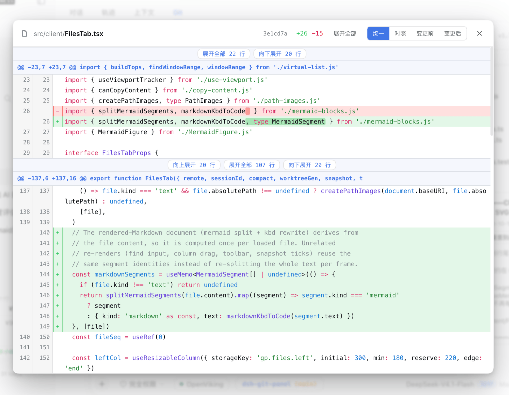
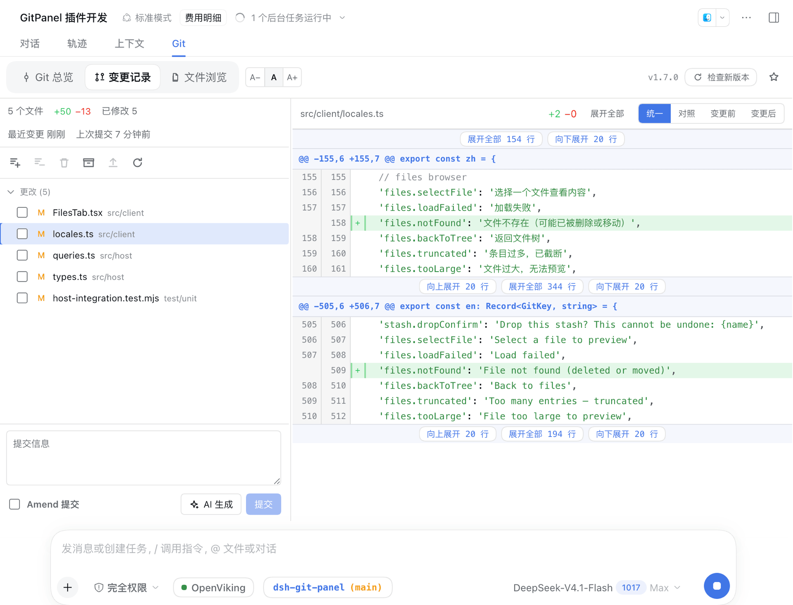
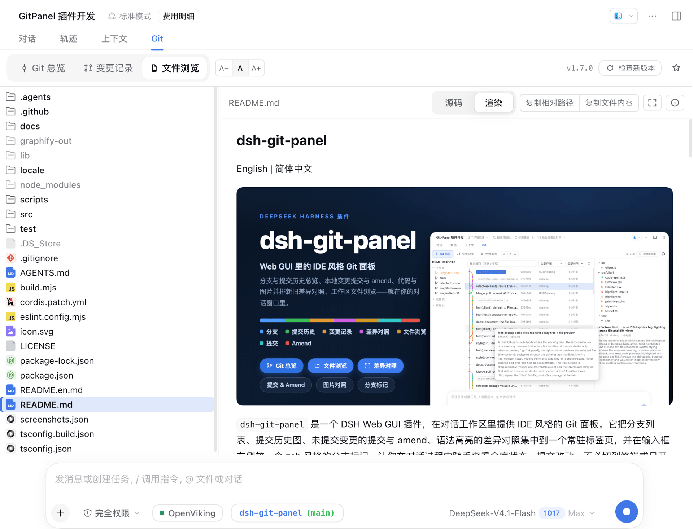

# dsh-git-panel

[English](README.en.md) | 简体中文


`dsh-git-panel` 是一个 DSH Web GUI 插件，在对话工作区里提供 IDE 风格的 Git 面板。它把分支列表、提交历史图、未提交变更的提交与 amend、语法高亮的差异对照集中到一个常驻标签页，并在输入框左侧放一个 zsh 风格的分支标记，让你在对话过程中随手查看仓库状态、提交改动，不必切到终端或另开 IDE。

面板只读取当前会话工作目录所在的 Git 仓库，所有 git 命令都以 argv 数组经宿主的 subprocess 服务执行，不拼接 shell 字符串，工作目录锁定在仓库根，并带超时与输出上限。插件不改动 git 配置，写操作（提交、amend、暂存、丢弃）都有明确入口。

## 安装

```bash
# npm（默认）
dsh plugin --profile web add @xbzbing/dsh-git-panel@latest

# 或从 GitHub 仓库安装（仓库已提交构建产物，无需本地构建）
dsh plugin --profile web add github:xbzbing/dsh-git-panel
```

安装或更新后，重启 `dsh web` 服务再刷新页面，工作区标签栏（「对话」「轨迹」之后）就会出现 **Git** 面板。插件分 host 与 client 两半，宿主挂载和 client bundle 清单都在服务启动时定型，因此代码更新（安装、`add` 覆盖 `lib`）通常需要重启服务，仅刷新页面可能看不到变化。面板内的配置项（详情页的输入框标记开关、差异默认视图）走配置热写，改动即时生效、无需重启。

> **兼容性**：已在 `dsh@0.2.1-rc.2` 上实测，安装、Git 面板、输入框标记与 host RPC 均可正常使用。

## 功能

- **Git 总览**：三栏——分支 / 标签列表、可搜索（提交信息、commit 哈希、作者、日期）的提交历史图、选中提交的变更文件树与提交信息；点文件在 modal 里查看该文件在此提交中的差异。
- **变更记录**：逐文件暂存 / 取消暂存 / 丢弃与批量放弃选中改动（二次确认）、手动提交与 **Amend**、贮藏（创建 / 应用 / 弹出 / 丢弃），以及文件数与增删行统计。
- **常用 Git 操作**：分支切换（远程引用落为同名跟踪分支，不留游离 HEAD；有未提交改动可先贮藏再切换）、标签创建与删除、提交还原 / 重置（硬重置会列出将丢弃的改动并要求额外勾选）。都只改写本地仓库，不自动推送。
- **AI 生成提交信息**：按当前未提交变更与仓库既有提交风格生成提交信息，语言默认跟随仓库历史自动推断（也可固定中文 / English），可在插件详情页关闭并调整输入预算、输出上限与超时。**生成会把 diff 内容发送给你在 DSH 中所配置模型的供应商。**
- **输入框 Git 标记**：zsh 风格的 `<仓库名> (<分支>)`，已同步为绿色、有未提交变更为橙色；悬停显示仓库路径，点击跳转面板。可在插件详情页关闭，改为在「Git」标签旁显示状态圆点。
- **文件浏览**：面板内直接浏览工作区目录树（按需加载、`.gitignore` 项半透明、不显示 `.git`）并预览代码 / Markdown / HTML / 图片；非 Git 目录也能用，以当前工作目录为根。
- **差异与源码查看**：统一 / 对照 / 变更前 / 变更后四种视图，语法高亮、词级改动强调、块间隐藏上下文按需展开，<kbd>Ctrl</kbd>/<kbd>⌘</kbd>+<kbd>F</kbd> 就地查找；图片以光标为锚点缩放（10%–800%）、可拖拽平移与全屏。
- **窄面板 / 移动端**：宽度 ≤620px 时自动切为单栏「钻取」布局（分支筛选改为底部弹层、提交行改两行式），变宽后自动恢复三栏。
- **共享工作区护栏**：与 dsh 的 AI 共用同一仓库，写操作弹窗统一提示「可直接让 AI 执行 Git 操作」；撞上 `.git/index.lock` 会自动重试一次并提示「Git 正忙」。
- UI 跟随 DSH 系统语言设置，支持简体中文和英文。

## 权限与数据边界

面板以 DSH 进程的权限运行，安装前值得知道这些边界：

- **Git 命令**：所有 git 命令都经宿主的 `subprocess` 服务执行——argv 数组、不拼接 shell 字符串、工作目录锁定在仓库根，每条命令带超时与输出上限；不使用 `--force`，也不改动 git 配置。
- **文件访问**：只读工作区内的文件（差异、文件浏览、AI 生成的输入），路径经校验并做 realpath 包含检查——软链指向仓库外一律拒绝，`.git` 不可浏览。**唯一的写盘动作**是「放弃未跟踪条目」：按你的确认直接删除工作区文件，条目本身是 Git 仓库时整批拒绝。
- **网络**：插件自身只发起一个请求——`GET https://api.github.com/repos/<owner>/<repo>/releases/latest`，用于版本条上的「有新版本」提示（5 秒超时，结果带进程内缓存）。`fetch` / `pull` / `push` / `publish` 只在你点击后经 git 命令联网，凭据始终由 git 处理；插件不读取、不存储、不返回任何令牌或凭据。
- **外部服务**：只有「AI 生成提交信息」会把 diff 内容发送给你在 DSH 中配置的模型供应商；模型调用由宿主完成，插件不持有凭据。
- **系统依赖**：需要 `git` CLI；未安装 git 或目录不是 Git 仓库时只显示文件浏览，以当前工作目录为根。

客户端 bundle（`lib/client.js`）不发起网络请求，只与宿主走同源 RPC；插件不采集遥测。面板字号、分栏宽度这类界面偏好只存在浏览器 localStorage，不含仓库内容。除 git 命令与被确认的删除外，插件代码不在工作区之外读写文件；详情页的配置项由宿主写进 profile 配置。

## 界面

| Git 总览 | 文件差异 modal |
| :---: | :---: |
|  |  |
| 变更记录 | 文件浏览 |
|  |  |

## 架构

插件分 host / client 两半，通过 typert Remote 网关通信。

- **Host**（`lib/host/`）：`gitPanel` 命名空间上的 Cordis + typert `GitPanelService`，暴露 `snapshot` / `run` / `query` / `suggest` / `version` 五个端点，仅做端点委托与生命周期接线；git 命令经宿主 `subprocess` 服务执行（argv 数组、无 shell、cwd 锁仓库根、超时 + 输出上限）；`suggest` 端点经宿主 `llm` 服务用你已配置的模型一次性生成提交信息。
- **Client**（`lib/client.js`）：一个 React 包，注册 `conversation.view` 面板和 `conversation.input.left` 标记。每会话一个快照控制器（轮询 + turn 完成后刷新 + 连接重置重拉），标记、变更记录页和统计条共用同一份快照，避免重复 git 命令。

## 开发

```bash
node build.mjs      # tsc（host d.ts）+ esbuild（host 逐模块 js + client bundle + testkit）
npm run typecheck   # 类型检查
npm run test:unit   # 纯算法与 host 端点单测（node --test）
npm run test:e2e    # 隔离的 file:// 无头浏览器 e2e（不碰任何运行中的实例）
npm test            # 单测 + e2e
```

host 产物按 `src/host/` 逐模块输出（一个源文件一个 js，堆栈直接落在出问题的模块），且不做压缩：typert 网关靠方法参数名做参数校验，压缩会改名并破坏 wire 契约。client 改动没有热重载，需重新构建并刷新页面。`lib/` 作为构建产物随 git 提交入库，改动 `src/` 后必须重新构建并提交，否则从 GitHub 安装会加载到过期入口；测试期生成的 `lib/testkit.mjs` 不入库。本地联调：把插件加入 dsh web profile 的 `dsh.profile.bundles`，用 `file:` 依赖指向本目录，构建后即生效。

## 项目结构

```text
src/
  host/
    types.ts        wire 数据模型的唯一权威源（client 直接复用）
    index.ts        GitPanelService：端点委托与生命周期接线
    git.ts          subprocess → 带超时的 GitRunner
    core.ts         workspace 解析 + snapshotForSession
    actions.ts      GitAction → git 命令序列（commit / amend / stage 等）
    queries.ts      history / diff / file-lines / image-diff / dir-list / file-content / show / branches / tags / worktree-stats
    suggest.ts      AI 生成提交信息（diff 收集 + 提交语言推断 + ctx.llm 一次性调用）
    parser.ts       git 输出解析为结构化数据
    version.ts      本包版本 + GitHub release 更新检查
  client/
    rpc.ts          gitPanel 端点的 client 面
    controller.ts   每会话快照控制器
    Panel.tsx       主面板壳：子 tab 路由 + 版本条
    OverviewTab.tsx Git 总览三栏 + hover 卡片
    ChangesTab.tsx  变更记录页
    FilesTab.tsx    文件浏览（懒加载目录树 + 文件预览）
    DiffView.tsx    差异视图（统一 / 并排 / 变更前 / 变更后）
    GitPill.tsx     输入框标记
    code-spans.ts   将语法高亮 token 按词级改动区间切分
    git-graph.ts    提交图车道布局
    file-tree.ts    路径折树
    diff.ts         unified diff → 并排行 + 统一行 + 统计
```

## 许可证

本项目采用 [MIT License](LICENSE)。
